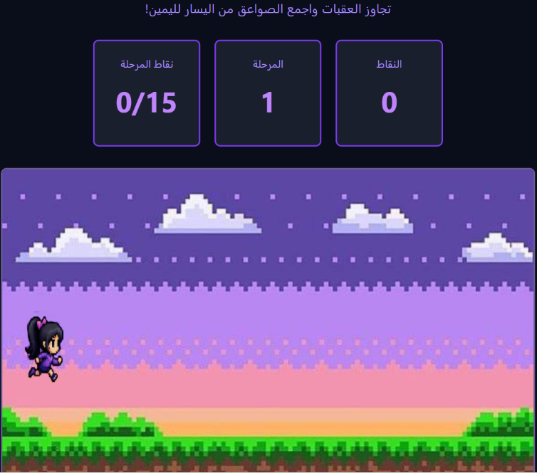

# ⚡ Lightning Adventure Game | لعبة الصاعقة

A browser-based pixel-art adventure game built with **HTML, CSS, and vanilla JavaScript**. Move the character vertically to collect lightning items, avoid obstacles, and progress through increasingly difficult levels.

لعبة مغامرات بسيطة بأسلوب البكسل، تعمل داخل المتصفح، وتعتمد على جمع الصواعق وتجنّب العقبات والانتقال بين المراحل.

## Features | المميزات

- Player movement using the keyboard (Arrow Up / Arrow Down or W / S).
- Collectible lightning items and a real-time score counter.
- Obstacle collision detection and game-over screen.
- Three levels with progressively faster movement and spawning.
- Start, pause/resume, and restart controls.
- Sound effects and pixel-art assets.

## Technologies | التقنيات

- HTML5 + Canvas
- CSS3
- JavaScript (DOM, events, animation, and collision detection)

## Run locally | التشغيل

1. Download this repository as a ZIP file and extract it.
2. Keep all files in the same folder.
3. Open `index.html` in Chrome or another modern desktop browser.
4. Press **ابدأ اللعبة** and use **↑ / ↓** or **W / S** to move.

**Note:** Keyboard controls are designed for desktop use. The game does not currently include touch controls for mobile phones.

## Live Demo

The GitHub Pages link will be added after the website is published.

## Project status

Educational front-end project for practicing JavaScript game mechanics. No server, login, or database is required.

## Assets

The project includes image and audio assets. Confirm permission to redistribute any third-party images or sound effects before making the repository public.
